<h1>GNS3 Setup with Cisco Images</h1>

<h2>Prerequisites</h2>

- Oracle VirtualBox should be installed
    - Can be installed from https://www.virtualbox.org/
    - Basic installation, just like any other application
- WinSCP
- `CiscoKeyGen.py` script
- Cisco IOU/IOS images
    - Can retrieve from this repo https://github.com/hegdepavankumar/Cisco-Images-for-GNS3-and-EVE-NG

<h2>Download</h2>

1. Download GNS3 all-in-one for Windows from https://www.gns3.com/software/download
2. Once downloaded, run the installer (.exe file)
    - It will ask to install other tools (e.g. SolarWinds, Wireshark, Pcap, etc)
    - Just install whatever that is default
3. Download GNS3 VM for Virtualbox (this is a zip archive of type .ova) from https://www.gns3.com/software/download-vm
    - Install the VirtualBox version
    - Extract the file to Desktop
4. Download and install VirtualBox https://www.virtualbox.org/wiki/Downloads 
5. Open VirtualBox > File > Import Appliance > Select the .ova file > Keep everything as default
6. Run GNS3, Setup wizard should appear > Select "Run appliances in a virtual machine"
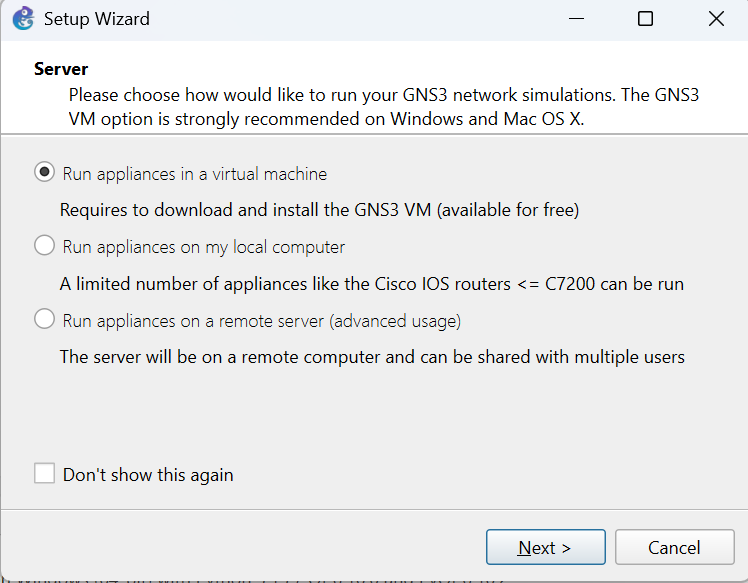 <br>
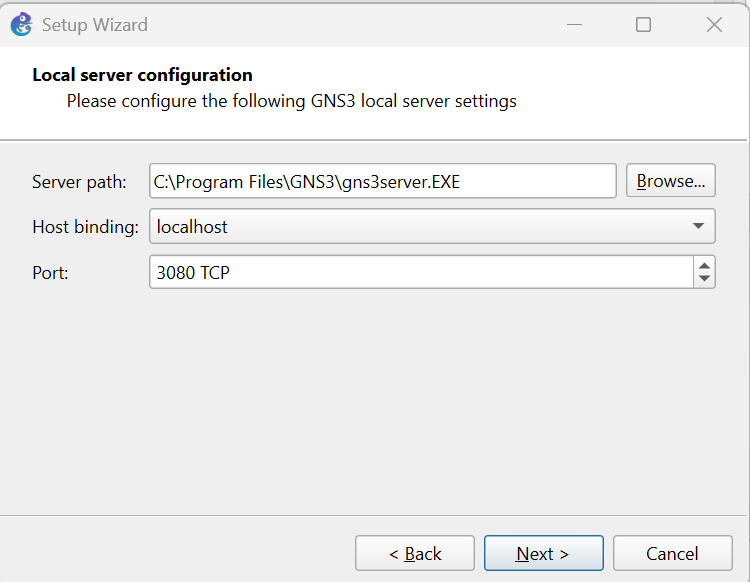 <br>
If the below warning occurs, select OK. It is not needed as we are using VirtualBox and not VMWare <br>
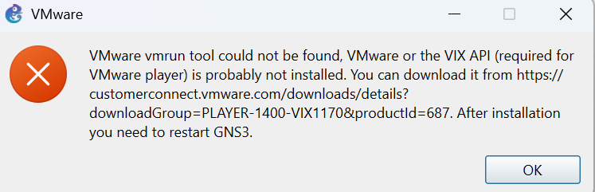 <br>
7. Set the following as shown below
    - You can increase `vCPU cores` and `RAM size` if able

    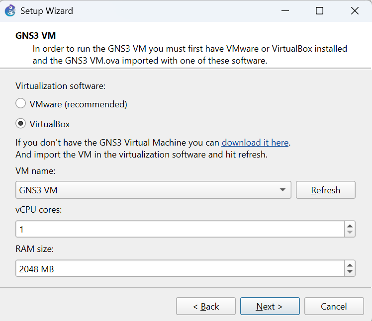 <br>
<br><br>


<h2>Installing IOU Images</h2>

1. Download the script for the license_key_generator and the image file
2. Run GNS3 and wait for the VM to load
3. Take note of the IP address on the GNS3 VM <br>
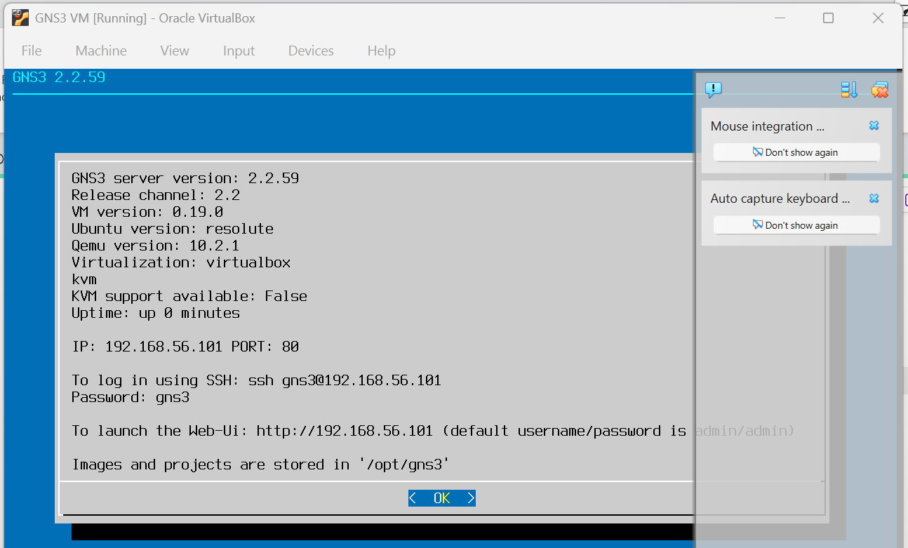 <br>
4. Open WinSCP > Access the GNS3 VM 
    - Password: `gns3`

    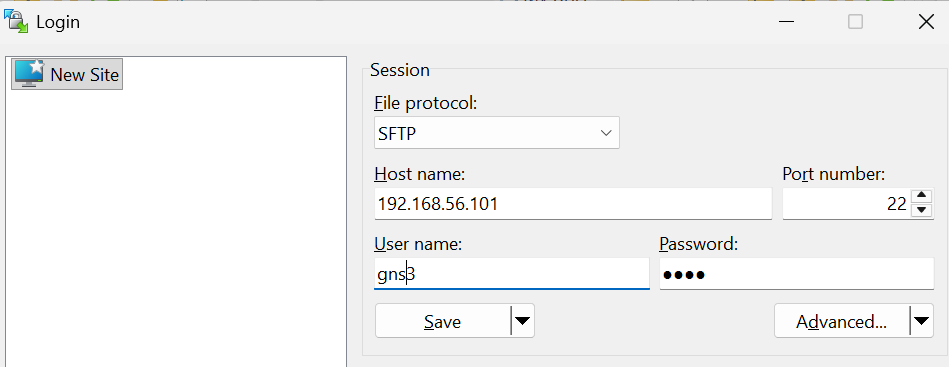 <br>
5. Go to directory `/opt/gns3/images`
6. Create a folder called `IOU`
7. Transfer the key_generator script `CiscoKeyGen.py` to the IOU folder
    - So the file path will be `/opt/gns3/images/IOU/CiscoKeyGen.py`
8. In the GNS3 VM, go to the Shell <br>
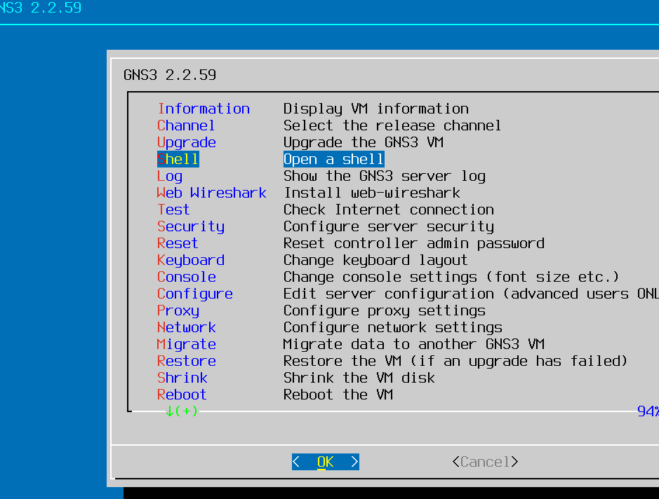 <br>
9. Run go to path `/opt/gns3/images/IOU`

    ```
    cd /opt/gns3/images/IOU
    ```
10. Run `CiscoKeyGen.py`

    ```
    python3 CiscoKeyGen.py
    ```
    - Note that the generated key is different for every computer
    - Because of copyright, I am unable to share the script. But you can find it online

    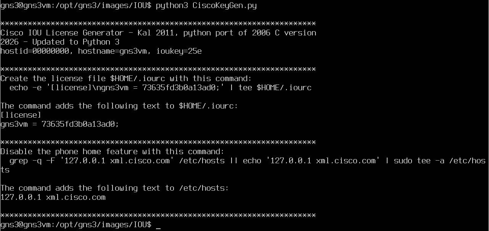 <br>
11. In the current directory `/opt/gns3/images/IOU`, create a file named `iourc.txt` and paste the license key inside
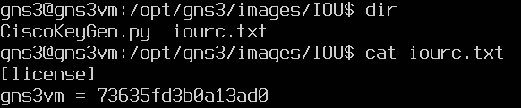 <br>
12. Copy the iourc.txt file into Windows machine as need to use the license key to set up the IOU in GNS3 GUI
    - Use WinSCP
13. Open GNS3 GUI > Edit > Preferences > IOS on UNIX > Paste the iourc.txt file > Apply
    - Note: add a ';' at the end of the key (don't need change the one inside the GNS3 VM)
    
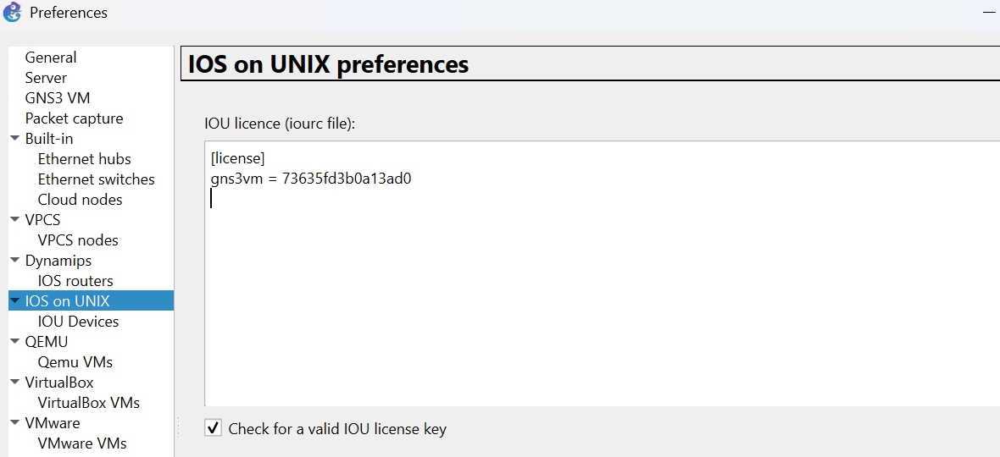 <br>
14. Preferences > IOU Devices > New > Run this IOU device on the GNS3 VM <br>
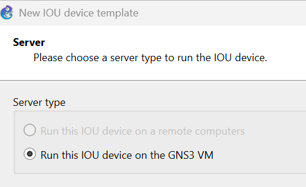 <br>
15. Add the IOU image
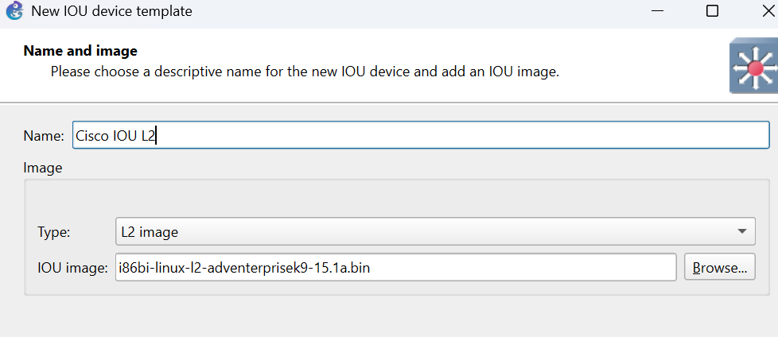 <br>
16. If you face the following error
 <br>
Do the following
- Open the GNS3 VM and go to the shell and follow the commands in the picture below (I used putty to SSH to the GNS3 VM, hence the different background interface)
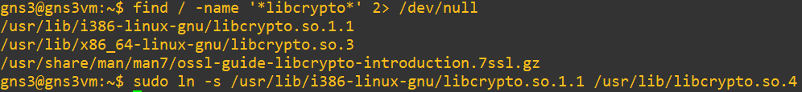 <br>
- Link to the video: [Linux: Fix GNS3 2.0.2 IOU Not Executable and libcrypto.so.4 Errors](https://www.youtube.com/watch?v=chcHuF3nEoQ)
- Should be able to run the IOU machine straight away after this